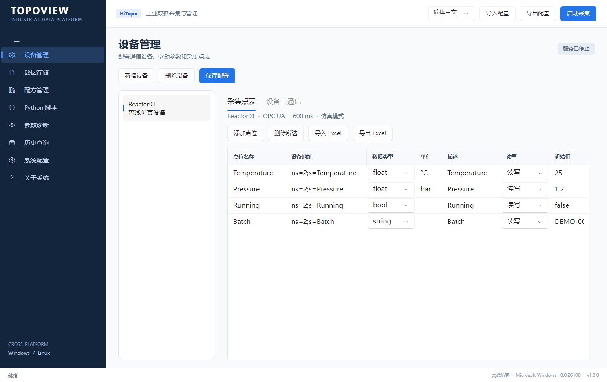

# TopoView

TopoData 的 Avalonia 桌面子项目，已加入同级 `HiTopo.sln`。使用 Avalonia 11.3.22、DataGrid 11.3.13、FluentAvalonia 2.4.1 和 .NET 8，面向 Windows / Linux 桌面。

界面采用深蓝汉堡侧栏、浅灰工作区、蓝色选中标记和适度圆角。导航保留 FluentAvalonia 的短时过渡；窗口小于 1200 像素时折叠为图标侧栏。点表支持列宽调整和横向滚动。



## 在 Visual Studio 调整界面

固定控件、布局、导航项目、表格列和业务弹窗均声明在 AXAML。C# 代码后置只处理数据装载、校验和具名事件，不再通过 `Ui.Row/Card/Form` 等工厂拼装界面。

1. 当前项目目标为 `.NET 8`，可使用 **Visual Studio 2022 17.8 或更新版本**及兼容的 .NET SDK；本机为 VS 2022 17.14.34。设计预览还需要与 Avalonia 11 兼容的扩展；本次没有安装或升级 IDE/扩展。
2. 使用兼容的 [Avalonia Visual Studio 工具](https://avaloniaui.net/visual-studio) 打开解决方案并编译 TopoView。
3. 在解决方案资源管理器展开 `TopoView / Views`，打开所需 `.axaml`；对应 `.axaml.cs` 会嵌套在其下方。`MainWindow.axaml` 是主窗口入口。
4. 在 AXAML 编辑器和预览中调整 Grid 行列、Margin、Padding、大小及顺序；保留 `x:Name`、Binding 和事件名称，或使用 IDE 的重命名功能同步更新代码后置。
5. 主题和公共样式在 `Styles/Industrial.axaml`；导航颜色在 `MainWindow.axaml` 的资源区。历史查询的未知数据库列复用 `HistoryPage.axaml` 中的 `HistoryColumnTemplate`，列外观也在 AXAML 修改。

设计构造与运行构造分开：每个页面和弹窗都有无参构造，可独立预览；无参构造不创建 `AppContextServices`，不读取共享生产配置，不启动定时采集、数据库或 OPC UA 客户端。运行时才由主窗口显式传入应用服务。

**拖放能力与许可边界：**官方 VS Plus 工具提供控件树和 Toolbox，支持把控件拖入 AXAML 标记并补齐命名空间。它不是已验证的 WinForms 式画布自由移动/缩放设计器；Toolbox 属于订阅功能，当前 Community 扩展仅非商业免费。Avalonia / FluentAvalonia 框架本身的开源许可不受影响。本次验证了真实 AXAML 的加载、渲染和交互，未在已安装的 VS2022 中完成拖放验收。

| TopoData 对应模块 | TopoView 布局文件 |
|---|---|
| `ucCannelCfg` | `Views/DevicesPage.axaml` |
| `ucDataTableCfg` | `Views/StoragePage.axaml` |
| `ucRecipe` | `Views/RecipesPage.axaml` |
| `ucScripts` | `Views/ScriptsPage.axaml` |
| `ucDiagnose` | `Views/DiagnosticsPage.axaml` |
| `ucHisQuery` | `Views/HistoryPage.axaml` |
| `ucSystemCfg` | `Views/SettingsPage.axaml` |
| `ucAbout` | `Views/AboutPage.axaml` |

控件使用编程规范中的 `txt/cmb/chk/btn/dgv/lst/lbl/grp/pnl` 类型前缀，业务字段继续沿用 `CannelID`、配方、触发条件等现有术语。公共页面类和配置/XML 字段名称保持兼容。

参考：[Avalonia 设计时设置](https://docs.avaloniaui.net/docs/app-development/xaml-preview-and-design-settings)、[微软 SDK / Visual Studio 支持矩阵](https://learn.microsoft.com/en-us/dotnet/core/porting/versioning-sdk-msbuild-vs)。

## 运行

开发需要 .NET 8 SDK 或支持该目标框架的更新 SDK。FluentAvalonia 3.x 和 2.5.x 的正式 NuGet 包仅提供 .NET 10 程序集，因此此项目固定使用兼容的 FluentAvalonia 2.4.1 和 Avalonia 11.3；不要只升级其中一个 UI 包的主版本。以 `TopoView` 为启动项目，或在解决方案目录执行：

```powershell
dotnet run --project TopoView/TopoView.csproj
```

离线演示（一个内存仿真设备及四个点位，不连接 PLC）：

```powershell
dotnet run --project TopoView/TopoView.csproj -- --demo
```

首次打开、切换页面和登录自动启动均只打开界面。WebAPI 与旧 TopoData 一致，随程序打开即监听（需在系统配置中启用且已有点表）；点击“启动采集”后，才启动配置中启用的设备、存储、脚本和 MQTT。

默认配置目录与旧 TopoData 相同，直接加载并保存同一组 XML 配置文件（复用 `auDASLib.pubDefine.Folder`：Windows 为 `C:\Users\Public\Documents\Config`，Linux 为程序目录下 `Config/`）。可通过 `--config-dir <目录>` 或环境变量 `TOPOVIEW_CONFIG_DIR` 指定独立配置目录；`--demo` 使用单独的 `DemoConfig`，不接触生产配置。

本次已生成的发布输出位于：

- `artifacts/publish-net8/win-x64/TopoView.exe`：Windows x64，需要 .NET 8 与 ASP.NET Core 8 运行时。
- `artifacts/publish-net8/linux-x64/TopoView`：Linux x64 独立发布，包含 .NET / ASP.NET Core 运行时。复制**整个目录**，赋予启动文件执行权限后运行；仍需要目标发行版的图形、字体及 .NET 原生系统依赖。

早期的 `artifacts/publish/`（.NET 10 预览期发布包）已在临时文件清理中移除；当前 .NET 8 输出使用上述独立目录，可用 `dotnet publish` 随时重新生成。

Linux 桌面建议安装中文字体（例如 Noto Sans CJK）。串口需要当前用户具有对应 `/dev/tty*` 设备权限。这是桌面项目，未包含 Android 启动项目或无界面守护进程安装。

## 功能对应

| TopoData 功能 | TopoView 实现 |
|---|---|
| 设备及点表 | OPC UA、Siemens S7、Modbus TCP / RTU；设备参数、仿真、类型和读写设置、点表增删、Excel 导入导出 |
| OPC UA 浏览 | 安全端点发现、按层浏览、属性查看、变量选择、限量递归导入 |
| 数据存储 | 上升沿、周期、双边沿触发；布尔点或 Flee 表达式；固定值、批号、普通表与公共时序表 |
| 配方 | 配方和参数维护、类型检查、诊断页下载、HTTP 下载接口 |
| Python | 脚本维护、表达式或布尔上升沿、`Read[设备.点位]`、手动执行、输出和错误、超时终止 |
| 参数诊断 | 实时值、质量、时间戳、连接状态、显式写入和配方提交 |
| 历史查询 | 日期时间、点位筛选、结果上限、数据库查询和 Excel 导出 |
| 系统设置 | SQLite / SQL Server / PostgreSQL / MySQL、WebAPI、MQTT、Python、旧配置导入、连接测试 |
| 其他 | 汉堡导航、中英文常用标签、独立日志、配置备份、用户登录启动界面 |

原免费版本限制保留：**1 个启用设备、50 个点位/设备、1 个启用存储任务、20 个数据列/任务**。

本项目不引用 DevExpress、WinForms 或 OPC DA / COM。采集引擎统一使用服务端的 **AnyCPU `hiServer.dll`**（`Runtime/hiServer.dll`）：OPC UA、Profinet S7、Modbus TCP / RTU 由该程序集实现，TopoView 只负责配置、界面与存储/脚本/API 宿主；`hiLib`、`Log4` 以项目引用保持与 DLL 版本一致。该 DLL 需保持 AnyCPU（无 32 位标记），重新构建命令见 csproj 注释；旧 `packages/hiServer.dll`（x86）仅服务旧 TopoData，勿与 `Runtime/hiServer.dll` 混用。OPC DA 已从程序集中移除，枚举与纯数据字段仅用于识别旧 XML 并报告排除项。

## 迁移旧配置

默认情况下 TopoView 与旧 TopoData 共用同一配置目录，现有配置会自动加载，无需迁移。以下步骤适用于把配置复制到另一台机器或使用独立目录的场景：

1. 停止 TopoView 采集，点击顶部“导入配置”选择旧 ZIP；也可在“系统配置”中导入旧 Config 文件夹。
2. 仅复制 `hiTopoCfg.xml`、`hiTopoTagDef.xml`、`hiTopoRecipeDef.xml`、`hiTopoPythonScriptDef.xml`、`mqtt_config.xml`；不修改来源。原 TopoView 文件保留为 `.bak`。XML 格式损坏时报告错误并阻止覆盖。
3. OPC DA 及其他未实现的设备类型被排除，关联存储任务与可识别的脚本触发被禁用。配方及脚本文本中的相关点位引用仍需人工检查。导入不继承另一台机器的登录启动项。
4. 检查 IP、端口、数据库、Python 路径以及 Linux 串口和 SQLite 路径，然后保存。启用任务的缺失点位或无效触发条件会阻止启动。
5. 先使用仿真及独立数据库验证，再启用真实设备。保持旧配置备份，可直接继续使用原 TopoData 项目。

Excel 点表前六列保持旧顺序：`TagId`（点位短名称）、`Address`、`DataType`、`UOM`、`Description`、`RW`。数据库表及列标识符限定为英文字母、数字、下划线，且不以数字开头；历史数据使用参数化查询。

Python 使用系统配置指定的外部解释器，不嵌入 Windows Python DLL。与旧版一致，解析后的脚本写入配置目录 `PythonScripts\` 下的 `.py` 文件后执行，并注入 `HITOPO_SCRIPT_NAME`、`HITOPO_TRIGGER_NAME`、`HITOPO_TRIGGER_VALUE`、`HITOPO_TRIGGER_TIME` 环境变量。旧版没有执行超时限制，此版同样默认不设超时；如需截止时间可在宿主代码中设置 `ScriptService.Timeout`。同一触发脚本不会重叠执行。旧脚本若依赖原进程内部对象、Windows 路径或第三方模块，需在目标 Python 环境适配。编辑器采用原生多行文本框，未复刻 Scintilla 的语法高亮。

界面中的“已提交”表示驱动接收了写请求。S7 / Modbus 沿用队列写入方式，应通过实时值回读确认；批量写入跨设备时不提供分布式回滚。坏质量的触发点不会被当作下降沿执行，也不会触发脚本。

存储语义与旧版一致：普通任务表中缺失或坏质量的数据列写入 NULL 并保留该行（上升沿任务在所有列都无效时才跳过本行），浮点值保留四位小数；公共时序表按运行值类型分别填入 `fvalue`、`bvalue`、`strvalue`，`seq_name` 取任务的报表名称。任务配置了工单点位时，采集运行期间同时维护旧版工单表 `tb_au_workorder`（按 `unit_id + wo_no` 更新结束时间或插入新工单）。

MQTT 发布保持旧版报文契约：JSON 使用 camelCase 字段名，批量报文时间戳为 `yyyy-MM-dd HH:mm:ss`，QoS 1，发布周期最小 500 ms，没有可发布数据时不发送空报文，只发布已启用设备的点位。

历史保留月数用于“清理过期历史”：先显示范围及行数，确认后在事务中删除。与旧版 `DbClear` 一致，采集运行期间还每小时自动删除超过保留月数（最小 1 个月）的历史行，覆盖公共时序表、应用日志表和各任务表。创建数据库、建表和手动清理均有显式入口。

配置 XML 和导出 ZIP 包含连接凭据，应按原配置文件管理权限。默认 WebAPI、MQTT 都关闭；示例 HTTP 地址为本机。保持原 API 风格，未新增用户身份认证，开放到其他主机时应由部署环境控制访问。

## OPC UA 证书

证书由共享引擎（`hiServer.dll`）按旧服务端方式使用当前用户证书仓库管理：客户端证书位于 `CurrentUser\My`（主题 `CN=UA Client RecipePRO`），服务器证书信任列表位于 `CurrentUser\Root`。

与旧 TopoData 客户端一致，客户端不区分服务器证书是否受信任，一律自动接受；旧 SHA-1 证书同样允许。因此连接成功不代表服务器身份已被核验，部署时仍需自行确认目标地址可信。服务器侧如果要求客户端证书，需要把 `CurrentUser\My` 中 `CN=UA Client RecipePRO` 的证书加入服务器的信任列表；不要导出私钥给服务器。普通无安全策略端点按所选端点连接。

旧配置中的 OPC DA 风格条目名（如 `通道.设备.标签`）在 OPC UA 模式下会自动按字符串标识符处理（`ns=2;s=…`，对应 KEPServerEX 的通道命名空间），转换会记录到运行日志；个别无效地址只跳过该点位，不影响同一设备的其他点位。要精确取值建议用“浏览变量”导入标准 NodeId 地址。

## HTTP 兼容入口

以下入口随程序打开启动（系统配置启用 REST 且已有点表时），停止采集不影响监听；失败响应保持旧版纯文本错误信息，写入接口保持旧版空数组返回。启用 REST 需重启程序，关闭后立即释放端口。

| 方法 | 路由 | 请求 |
|---|---|---|
| POST | `/api/Data/GetRealtimeValues` | 点位完整名称的 JSON 数组 |
| POST | `/api/Data/WriteRealtimeValues` | 原 `WriteValue` JSON 数组 |
| POST | `/api/Recipe/DownloadRecipe` | 配方名称或 ID 的 JSON 字符串 |
| GET | `/api/Status/GetServerStatus` | 原状态数据结构 |
| GET | `/api/Status/GetStatus` | 新运行状态及设备连接状态 |
| GET | `/api/OPCUA/GetUAEndpoints?uri=...` | OPC UA 地址 |
| POST | `/api/Command/StartCannel`、`StopCannel`、`AddCannel` | 原空操作路由，保留以兼容旧客户端 |

`DownloadRecipe` 保持旧版语义：名称为空返回 404，配方不存在返回 404，配方未启用（`recipe_status` 不是 InUse）返回 400，名称或 ID 匹配不区分大小写。批量写入与配方下载都按项/按设备继续执行，单条失败不中断整批。

## 构建与检查

```powershell
dotnet build TopoView/TopoView.csproj
dotnet run --project TopoView/Tests/TopoView.Tests.csproj -- <Python可执行文件完整路径>
dotnet publish TopoView/TopoView.csproj -c Release -r linux-x64 --self-contained true -o TopoView/artifacts/publish-net8/linux-x64
```

测试程序只使用自建隔离目录、内存设备、localhost HTTP / Modbus 服务和 SQLite。传入 Python 路径可同时检查脚本执行及超时。测试不会访问旧生产配置、PLC、远程数据库、MQTT Broker 或注册登录启动项。页面截图保存在 `artifacts/tests`。

本次验证及边界见 [VALIDATION.md](VALIDATION.md)，依赖和原作者声明见 [THIRD_PARTY_NOTICES.md](THIRD_PARTY_NOTICES.md)。
